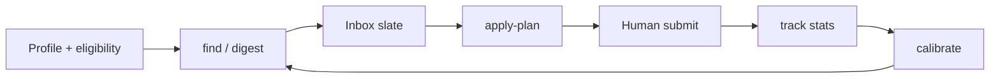

# JobKit

Local-first job-search toolkit. v0.10.0.

Finds roles, scores fit, prepares packages, and tracks the funnel. It does **not** submit applications. It does **not** invent experience.

:::warning Human review
A human must review every package before any send. JobKit never clicks submit.
:::

:::info Search boundary
`jobkit find` queries public Greenhouse, Lever, and Ashby APIs only.
:::
