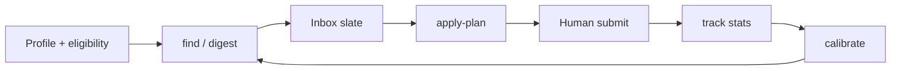

# JobKit

Local-first job-search toolkit. v0.9.0.

Finds roles, scores fit, prepares packages, and tracks the funnel.

It does **not** submit applications. It does **not** invent experience.

=== "Does"

    - Keep candidate state on this computer
    - Score fit from a reviewed profile
    - Prepare packages a human can send
    - Record history in append-only ledgers

=== "Does not"

    - Submit a form
    - Send outreach
    - Scrape LinkedIn, Wellfound, Google Jobs, or Indeed
    - Invent a metric, skill, or claim
    - Publish `~/.jobkit`

!!! warning "Human review"
    A human must review every package before any send. JobKit never clicks submit.

!!! note "Search boundary"
    `jobkit find` queries public Greenhouse, Lever, and Ashby APIs only.

- [First hour](guides/first-hour.md)
- [Command map](reference/commands.md)
